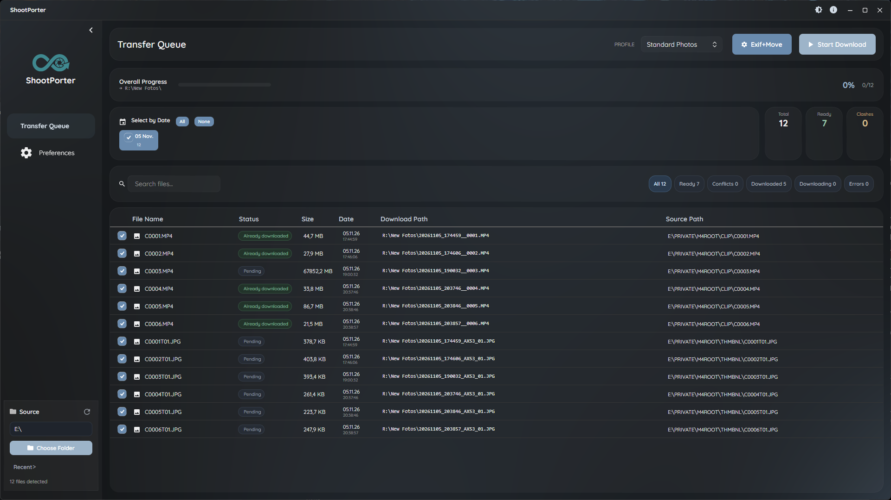
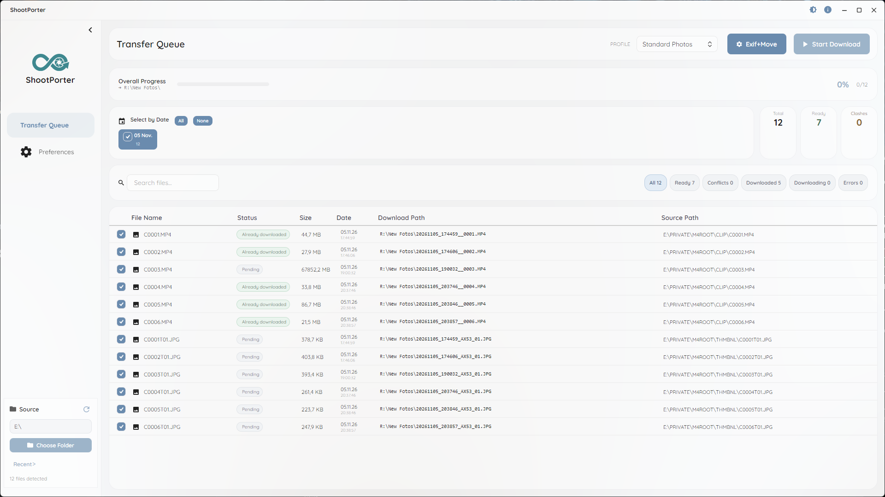
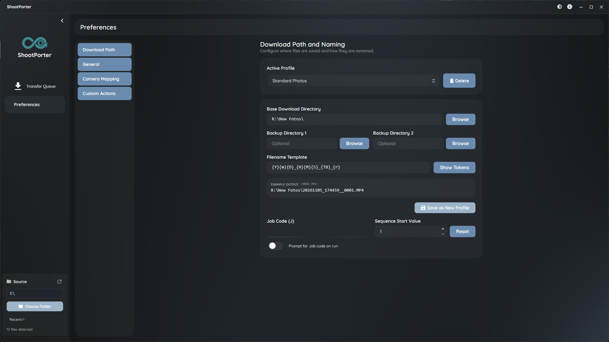
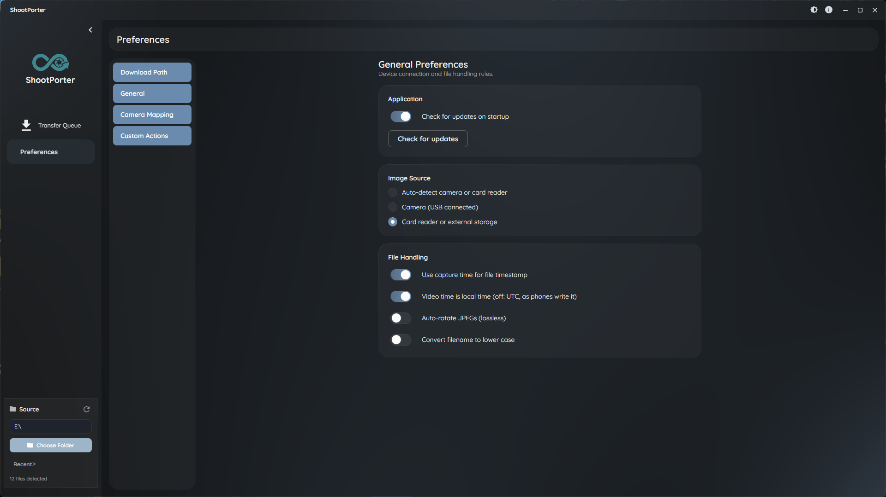
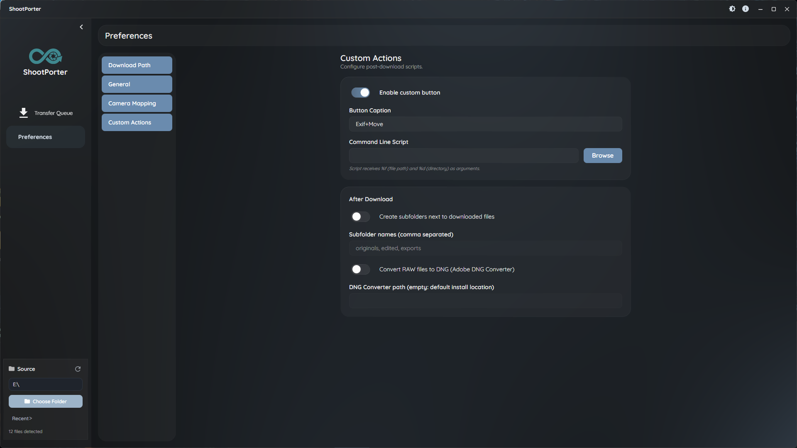

[English](README.md) | **Deutsch** | [Русский](README.ru.md)

# ShootPorter

Ein Programm für Fotografen, das Fotos und Videos herunterlädt und ordnet.

ShootPorter kopiert Fotos und Videos von Speicherkarten und aus Ordnern in dein Archiv. Es benennt die Dateien anhand ihrer Metadaten mit `{Tokens}` um, erkennt bereits heruntergeladene Dateien, kann zusätzlich in zwei Backup-Ordner kopieren und löscht die Karte erst nach einer geprüften Kopie.

Gebaut mit **.NET 10** und **Avalonia UI**. Die Releases gibt es für Windows; der Code läuft auch unter macOS und Linux.



| Helles Theme | Benennung und Profile |
|---|---|
|  |  |
| **Allgemeine Einstellungen** | **Eigene Aktionen** |
|  |  |

---

## Download

Lade `ShootPorter-win-Setup.exe` aus dem [neuesten Release](https://github.com/Diddlik/ShootPorter/releases/latest). Die App aktualisiert sich selbst: Sie prüft beim Start, und **Preferences → General → Check for updates** prüft sofort.

---

## Funktionen

### Download
- Quellen: Kartenleser, Wechseldatenträger (werden automatisch angezeigt) und jeder lokale Ordner oder Netzwerkordner
- Parallele Kopien mit Fortschritt pro Datei und gesamt
- **Bereits heruntergeladen**: Gibt es die Zieldatei schon mit gleichem Namen und gleicher Größe, wird sie markiert und übersprungen
- Namenskonflikte werden vor dem Download angezeigt; bei einer vorhandenen Zieldatei wählst du Überschreiben, Suffix anhängen (`_01`, `_02`) oder Abbrechen
- Bis zu zwei Backup-Ordner
- Optional Löschen von der Karte, aber erst wenn der SHA-256-Hash von Quelle und jeder Kopie übereinstimmt
- Begleitdateien (XMP, WAV, THM) werden mit ihrer Hauptdatei kopiert

### Benennung mit Tokens
Zielordner und Dateinamen werden aus `{Tokens}` gebaut:

| Token | Beschreibung | Beispiel |
|-------|--------------|----------|
| `{Y}`, `{m}`, `{D}` | Jahr, Monat, Tag | `2026`, `03`, `29` |
| `{H}`, `{M}`, `{S}` | Stunde, Minute, Sekunde | `14`, `30`, `05` |
| `{J}` | Job-Code | `Hochzeit_Schmidt` |
| `{F}`, `{e}` | Ursprünglicher Dateiname, Endung | `IMG_1234`, `CR3` |
| `{r}` | Bildnummer aus dem Originalnamen | `1234` |
| `{T8}`, `{T9}` | Werte aus der Kamera-Zuordnung | `R6` |
| `{seq#4}` | Laufende Nummer (mit Nullen aufgefüllt) | `0001` |
| `{file[5-10]}` | Teil des Dateinamens | `1234` |

Textfunktionen: `{upper,...}`, `{lower,...}`, `{left,n,...}`, `{right,n,...}`, `{mid,n,m,...}`, `{capitalize,...}`, `{default,...}`, `{if,...}`. **Show Tokens** in der App zeigt alle Tokens.

**Beispiel:** `{Y}-{m}-{D}\{J}\{F}.{e}` ergibt `2026-03-29\Hochzeit_Schmidt\IMG_1234.CR3`

### Aufnahmezeit
- Fotos: EXIF `DateTimeOriginal`
- Videos: die Uhrzeit der Kamera aus der zuverlässigsten Quelle in der Datei: Sony-Clip-XML (neben dem Clip oder in der MP4), das QuickTime-Feld `creationdate` (Handys), XMP oder der MP4-Header mit der Zeitzone der Kamera, die aus dem Dateidatum ermittelt wird. Die Einstellung „Video time is local time“ ist nur der letzte Ausweg.

### Profile und Einstellungen
- Benannte Profile mit Zielordner und Namensvorlage
- Kamera-Zuordnung: Modell und Seriennummer auf eigene Werte für `{T8}` / `{T9}`
- Job-Code mit Liste der zuletzt benutzten Codes; die laufende Nummer geht nach jedem Download weiter
- Die Einstellungen liegen als JSON in `%AppData%/ShootPorter`

### Nach dem Download
- Unterordner neben den heruntergeladenen Dateien anlegen (zum Beispiel `originals, edited, exports`)
- RAW-Dateien mit Adobe DNG Converter in DNG umwandeln
- Ein eigener Button, der ein eigenes Skript startet

### Kommandozeile
```
ShootPorter.exe --source E:\ --profile "Standard Photos" --jobcode Schmidt_2026
```

| Option | Beschreibung |
|--------|--------------|
| `--source` | Quellordner oder Laufwerk, das beim Start eingelesen wird |
| `--profile` | Profil, das ausgewählt wird |
| `--jobcode` | Job-Code |

`--dest`, `--parallel`, `--no-verify`, `--auto-delete`, `--no-recursive` und `--headless` werden eingelesen, aber noch nicht verwendet.

### Geplant
- GPS: GPX-Tracks zuordnen und Ortsnamen von [GeoNames](https://www.geonames.org/) (der Code im Core ist da, die App nutzt ihn noch nicht)
- Verlustfreies Drehen von JPEGs
- Betrieb ohne Oberfläche (headless)

---

## Unterstützte Formate

| Art | Formate |
|-----|---------|
| **Bilder** | JPEG, TIFF, PNG, HEIF, HEIC |
| **RAW** | CR2, CR3, NEF, NRW, ARW, DNG, RAF, ORF, PEF, GPR, RW2, SRW, 3FR, IIQ |
| **Video** | MOV, MP4, AVI, MTS, 3GP, CRM, MXF |
| **Begleitdateien** | XMP, WAV, THM (werden mit der Hauptdatei kopiert, z. B. `IMG_0001.xmp` oder `IMG_0001.CR3.xmp`) |

---

## Technik

| Ebene | Technik |
|-------|---------|
| **Laufzeit** | .NET 10 |
| **Oberfläche** | [Avalonia UI](https://avaloniaui.net/) 11 mit [SukiUI](https://github.com/kikipoulet/SukiUI) |
| **MVVM** | [CommunityToolkit.Mvvm](https://github.com/CommunityToolkit/dotnet) |
| **Metadaten** | [MetadataExtractor](https://github.com/drewnoakes/metadata-extractor-dotnet) |
| **Updates** | [Velopack](https://velopack.io/) mit GitHub Releases |
| **Logging** | [Serilog](https://serilog.net/) (`%LocalAppData%/ShootPorter/logs`) |
| **Tests** | [xUnit](https://xunit.net/) |

---

## Projektaufbau

```
ShootPorter/
├── src/
│   ├── ShootPorter.App/        # Avalonia-Desktop-App (Views, ViewModels, Update-Dienst)
│   └── ShootPorter.Core/       # Geschäftslogik ohne UI-Abhängigkeiten
│       ├── Cli/                # Kommandozeile
│       ├── Dedup/              # Erkennung bereits heruntergeladener Dateien
│       ├── Discovery/          # Einlesen, Formate, Laufwerksüberwachung
│       ├── Download/           # Parallele Kopien, Backups, Prüfung
│       ├── Geo/                # GPX und GeoNames (von der App noch nicht genutzt)
│       ├── Metadata/           # EXIF/IPTC und Aufnahmezeit von Videos
│       ├── Plugins/            # Aktionen nach dem Download
│       ├── Profiles/           # Kamera-Zuordnung, Job-Code-Verlauf
│       └── Tokens/             # Token-Vorlagen
├── tests/
│   ├── ShootPorter.Core.Tests/
│   └── ShootPorter.App.Tests/
└── screenshots/
```

---

## Selbst bauen

Benötigt das [.NET 10 SDK](https://dotnet.microsoft.com/download).

```bash
git clone https://github.com/Diddlik/ShootPorter.git
cd ShootPorter
dotnet build
dotnet run --project src/ShootPorter.App
dotnet test
```

---

## Architektur

- **ShootPorter.Core** enthält die gesamte Logik und hängt nicht von der Oberfläche ab.
- **ShootPorter.App** ist eine dünne Avalonia-Schicht: Views binden an ViewModels und enthalten keine Logik.
- Durchgehend asynchron mit `CancellationToken`; Dateien werden geprüft, bevor etwas gelöscht wird.
- Alle Texte der Oberfläche und alle Log-Meldungen stehen in `Properties/Resources.resx`.

---

## Hintergrund

ShootPorter ist eine Neuentwicklung von **Downloader Pro** von Breeze Systems, einem Windows-Programm, das Fotografen viele Jahre benutzt haben.

## Lizenz

Noch offen
