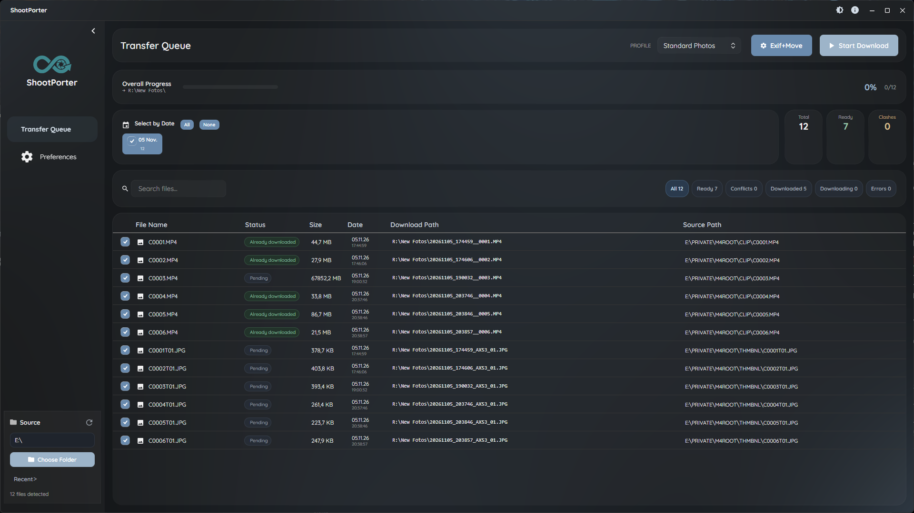
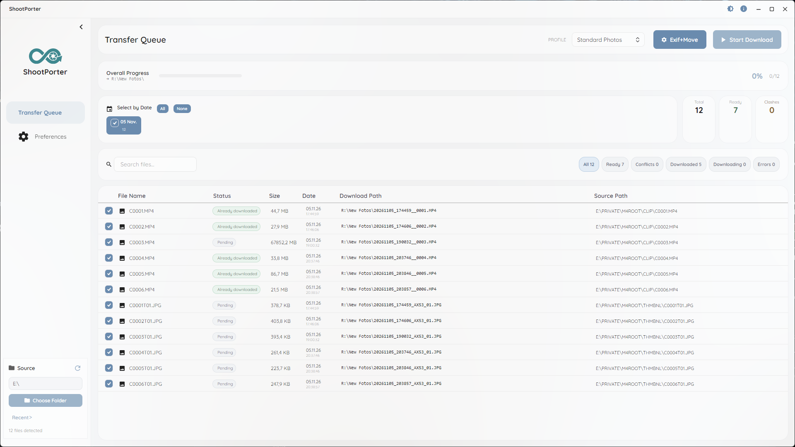
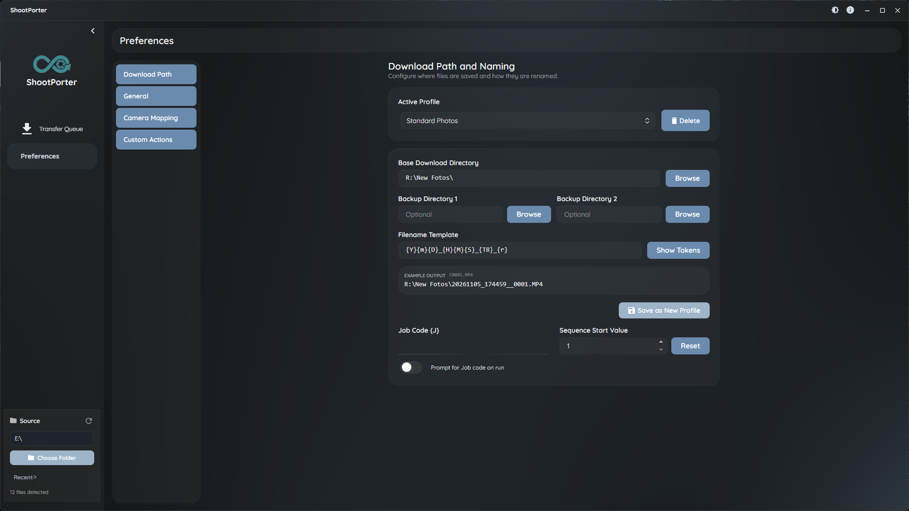
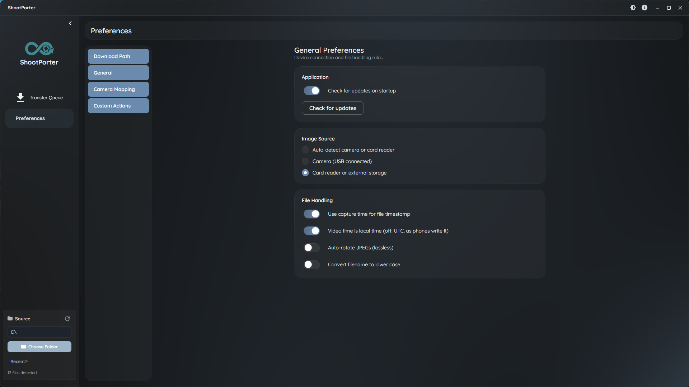
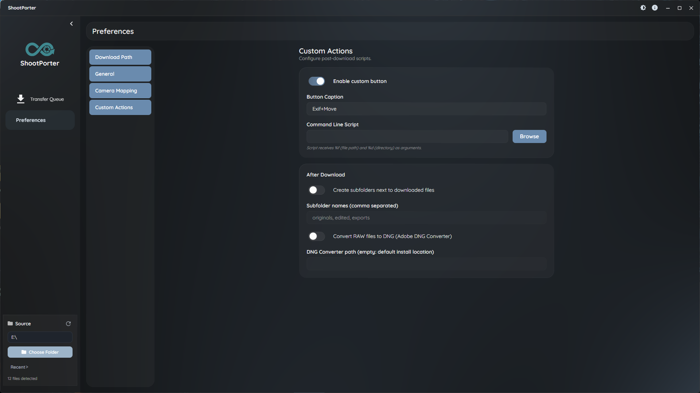

**English** | [Deutsch](README.de.md) | [Русский](README.ru.md)

# ShootPorter

A photo and video downloader and organizer for photographers.

ShootPorter copies photos and videos from memory cards and folders to your archive. It renames files from their metadata with `{tokens}`, recognizes files that were already downloaded, can back up to two more places and deletes the card only after a verified copy.

Built with **.NET 10** and **Avalonia UI**. Releases are built for Windows; the code also runs on macOS and Linux.



| Light theme | Naming and profiles |
|---|---|
|  |  |
| **General settings** | **Custom actions** |
|  |  |

---

## Download

Get `ShootPorter-win-Setup.exe` from the [latest release](https://github.com/Diddlik/ShootPorter/releases/latest). The app updates itself: it checks on startup, and **Preferences → General → Check for updates** checks on demand.

---

## Features

### Download
- Sources: card readers, removable drives (listed automatically) and any local or network folder
- Parallel copies with live progress per file and overall
- **Already downloaded**: a file whose target already exists with the same name and size is marked and skipped
- Name clashes are shown before the download; for an existing target you choose overwrite, add a suffix (`_01`, `_02`) or cancel
- Up to two backup folders
- Optional delete from the card, only after a SHA-256 match between the source and every copy
- Sidecars (XMP, WAV, THM) are copied with their main file

### Naming with tokens
Destination folders and file names are built from `{tokens}`:

| Token | Description | Example |
|-------|-------------|---------|
| `{Y}`, `{m}`, `{D}` | Year, month, day | `2026`, `03`, `29` |
| `{H}`, `{M}`, `{S}` | Hour, minute, second | `14`, `30`, `05` |
| `{J}` | Job code | `Wedding_Smith` |
| `{F}`, `{e}` | Original file name, extension | `IMG_1234`, `CR3` |
| `{r}` | File number from the original name | `1234` |
| `{T8}`, `{T9}` | Camera mapping values | `R6` |
| `{seq#4}` | Sequence counter (zero-padded) | `0001` |
| `{file[5-10]}` | Part of the file name | `1234` |

String functions: `{upper,...}`, `{lower,...}`, `{left,n,...}`, `{right,n,...}`, `{mid,n,m,...}`, `{capitalize,...}`, `{default,...}`, `{if,...}`. **Show Tokens** in the app lists all tokens.

**Example:** `{Y}-{m}-{D}\{J}\{F}.{e}` gives `2026-03-29\Wedding_Smith\IMG_1234.CR3`

### Capture time
- Photos: EXIF `DateTimeOriginal`
- Videos: the camera clock from the most reliable source in the file: Sony clip XML (next to the clip or inside the MP4), the QuickTime `creationdate` key (phones), XMP, or the movie header with the camera time zone derived from the file time. The setting "Video time is local time" is only the last resort.

### Profiles and settings
- Named profiles with destination and naming template
- Camera mapping: model and serial number to your own values for `{T8}` / `{T9}`
- Job code with a list of recently used codes; the sequence continues after each download
- Settings are stored as JSON in `%AppData%/ShootPorter`

### After download
- Create subfolders next to the downloaded files (for example `originals, edited, exports`)
- Convert RAW files to DNG with Adobe DNG Converter
- A custom button that runs your own script

### Command line
```
ShootPorter.exe --source E:\ --profile "Standard Photos" --jobcode Smith_2026
```

| Flag | Description |
|------|-------------|
| `--source` | Source folder or drive to scan at startup |
| `--profile` | Profile to select |
| `--jobcode` | Job code value |

`--dest`, `--parallel`, `--no-verify`, `--auto-delete`, `--no-recursive` and `--headless` are parsed but not used yet.

### Planned
- GPS: GPX track matching and place names from [GeoNames](https://www.geonames.org/) (the Core code exists, the app does not use it yet)
- Lossless JPEG rotation
- Headless mode

---

## Supported formats

| Category | Formats |
|----------|---------|
| **Images** | JPEG, TIFF, PNG, HEIF, HEIC |
| **RAW** | CR2, CR3, NEF, NRW, ARW, DNG, RAF, ORF, PEF, GPR, RW2, SRW, 3FR, IIQ |
| **Video** | MOV, MP4, AVI, MTS, 3GP, CRM, MXF |
| **Sidecars** | XMP, WAV, THM (copied with their main file, e.g. `IMG_0001.xmp` or `IMG_0001.CR3.xmp`) |

---

## Tech stack

| Layer | Technology |
|-------|-----------|
| **Runtime** | .NET 10 |
| **UI** | [Avalonia UI](https://avaloniaui.net/) 11 with [SukiUI](https://github.com/kikipoulet/SukiUI) |
| **MVVM** | [CommunityToolkit.Mvvm](https://github.com/CommunityToolkit/dotnet) |
| **Metadata** | [MetadataExtractor](https://github.com/drewnoakes/metadata-extractor-dotnet) |
| **Updates** | [Velopack](https://velopack.io/) with GitHub Releases |
| **Logging** | [Serilog](https://serilog.net/) (`%LocalAppData%/ShootPorter/logs`) |
| **Tests** | [xUnit](https://xunit.net/) |

---

## Project structure

```
ShootPorter/
├── src/
│   ├── ShootPorter.App/        # Avalonia desktop app (views, view models, update service)
│   └── ShootPorter.Core/       # Business logic, no UI dependencies
│       ├── Cli/                # Command-line parsing
│       ├── Dedup/              # Already-downloaded detection
│       ├── Discovery/          # Scanning, supported formats, drive watcher
│       ├── Download/           # Parallel copies, backups, verification
│       ├── Geo/                # GPX and GeoNames (not used by the app yet)
│       ├── Metadata/           # EXIF/IPTC and video capture time
│       ├── Plugins/            # After-download actions
│       ├── Profiles/           # Camera mapping, job code history
│       └── Tokens/             # Token template engine
├── tests/
│   ├── ShootPorter.Core.Tests/
│   └── ShootPorter.App.Tests/
└── screenshots/
```

---

## Build from source

Requires the [.NET 10 SDK](https://dotnet.microsoft.com/download).

```bash
git clone https://github.com/Diddlik/ShootPorter.git
cd ShootPorter
dotnet build
dotnet run --project src/ShootPorter.App
dotnet test
```

---

## Architecture

- **ShootPorter.Core** holds all business logic and has no UI dependencies.
- **ShootPorter.App** is a thin Avalonia shell: views bind to view models, views contain no logic.
- Async end-to-end with `CancellationToken`; files are verified before anything is deleted.
- All UI text and log messages are in `Properties/Resources.resx`.

---

## Background

ShootPorter is a rewrite of **Downloader Pro** by Breeze Systems, a Windows tool that photographers used for many years.

## License

TBD
