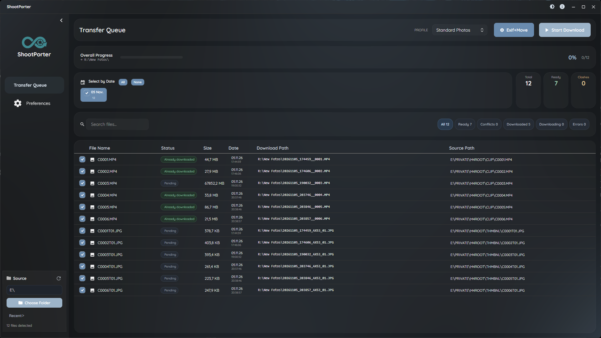
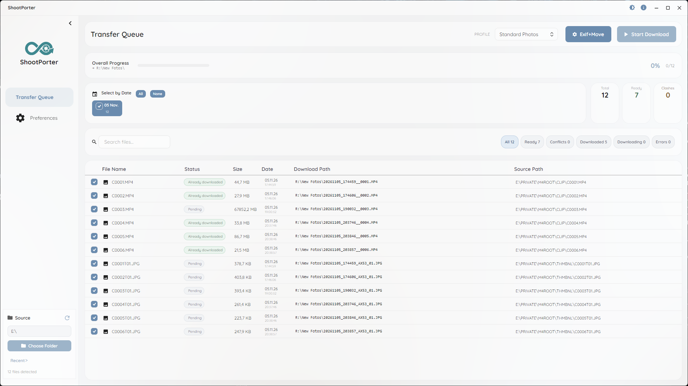
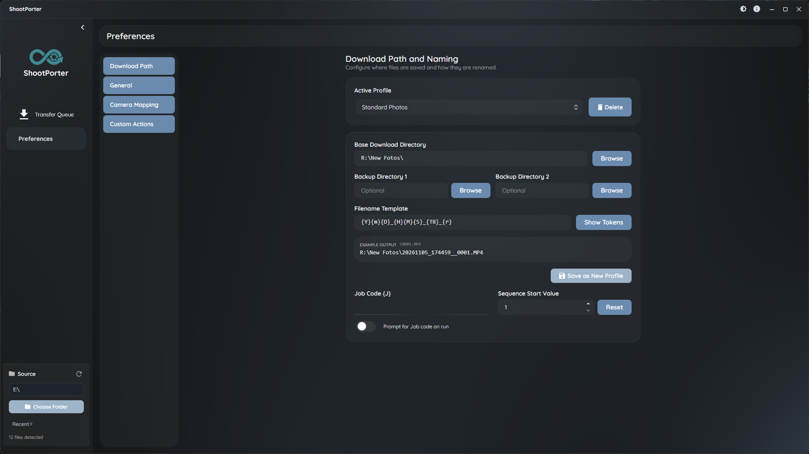
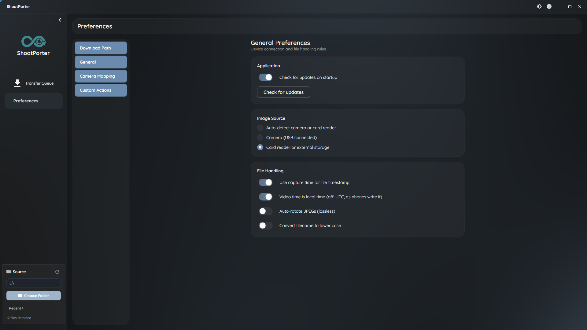
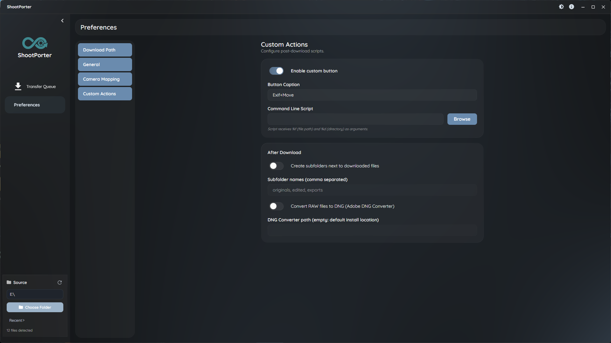

[English](README.md) | [Deutsch](README.de.md) | **Русский**

# ShootPorter

Программа для фотографов, которая загружает и упорядочивает фото и видео.

ShootPorter копирует фото и видео с карт памяти и из папок в ваш архив. Он переименовывает файлы по их метаданным с помощью `{токенов}`, узнаёт уже загруженные файлы, может делать копии ещё в две папки и удаляет файлы с карты только после проверенного копирования.

Создан на **.NET 10** и **Avalonia UI**. Готовые версии собираются для Windows; код работает также на macOS и Linux.



| Светлая тема | Имена и профили |
|---|---|
|  |  |
| **Общие настройки** | **Свои действия** |
|  |  |

---

## Скачать

Скачайте `ShootPorter-win-Setup.exe` из [последнего релиза](https://github.com/Diddlik/ShootPorter/releases/latest). Программа обновляется сама: она проверяет обновления при запуске, а кнопка **Preferences → General → Check for updates** проверяет сразу.

---

## Возможности

### Загрузка
- Источники: картридеры, съёмные диски (показываются автоматически) и любая локальная или сетевая папка
- Параллельное копирование с прогрессом по каждому файлу и общим
- **Уже загружено**: если файл с таким же именем и размером уже есть в папке назначения, он отмечается и пропускается
- Конфликты имён видны до загрузки; если файл уже существует, можно перезаписать его, добавить суффикс (`_01`, `_02`) или отменить
- До двух папок для резервных копий
- По желанию удаление с карты, но только если SHA-256 источника совпадает с каждой копией
- Сопутствующие файлы (XMP, WAV, THM) копируются вместе с основным файлом

### Имена из токенов
Папки и имена файлов строятся из `{токенов}`:

| Токен | Описание | Пример |
|-------|----------|--------|
| `{Y}`, `{m}`, `{D}` | Год, месяц, день | `2026`, `03`, `29` |
| `{H}`, `{M}`, `{S}` | Час, минута, секунда | `14`, `30`, `05` |
| `{J}` | Код заказа | `Svadba_Ivanov` |
| `{F}`, `{e}` | Исходное имя файла, расширение | `IMG_1234`, `CR3` |
| `{r}` | Номер снимка из исходного имени | `1234` |
| `{T8}`, `{T9}` | Значения из привязки камеры | `R6` |
| `{seq#4}` | Порядковый номер (с нулями впереди) | `0001` |
| `{file[5-10]}` | Часть имени файла | `1234` |

Строковые функции: `{upper,...}`, `{lower,...}`, `{left,n,...}`, `{right,n,...}`, `{mid,n,m,...}`, `{capitalize,...}`, `{default,...}`, `{if,...}`. Кнопка **Show Tokens** в программе показывает все токены.

**Пример:** `{Y}-{m}-{D}\{J}\{F}.{e}` даёт `2026-03-29\Svadba_Ivanov\IMG_1234.CR3`

### Время съёмки
- Фото: EXIF `DateTimeOriginal`
- Видео: время по часам камеры из самого надёжного источника в файле: XML клипа Sony (рядом с клипом или внутри MP4), поле QuickTime `creationdate` (телефоны), XMP или заголовок MP4 с часовым поясом камеры, который определяется по дате изменения файла. Настройка «Video time is local time» используется только в последнюю очередь.

### Профили и настройки
- Именованные профили с папкой назначения и шаблоном имени
- Привязка камеры: модель и серийный номер к своим значениям для `{T8}` / `{T9}`
- Код заказа со списком недавно использованных кодов; порядковый номер продолжается после каждой загрузки
- Настройки хранятся в JSON в `%AppData%/ShootPorter`

### После загрузки
- Создать подпапки рядом с загруженными файлами (например `originals, edited, exports`)
- Преобразовать RAW в DNG с помощью Adobe DNG Converter
- Своя кнопка, которая запускает ваш скрипт

### Командная строка
```
ShootPorter.exe --source E:\ --profile "Standard Photos" --jobcode Ivanov_2026
```

| Параметр | Описание |
|----------|----------|
| `--source` | Папка или диск, который сканируется при запуске |
| `--profile` | Профиль, который будет выбран |
| `--jobcode` | Код заказа |

`--dest`, `--parallel`, `--no-verify`, `--auto-delete`, `--no-recursive` и `--headless` читаются, но пока не используются.

### В планах
- GPS: привязка треков GPX и названия мест из [GeoNames](https://www.geonames.org/) (код в Core есть, программа его пока не использует)
- Поворот JPEG без потерь
- Режим без интерфейса (headless)

---

## Поддерживаемые форматы

| Тип | Форматы |
|-----|---------|
| **Изображения** | JPEG, TIFF, PNG, HEIF, HEIC |
| **RAW** | CR2, CR3, NEF, NRW, ARW, DNG, RAF, ORF, PEF, GPR, RW2, SRW, 3FR, IIQ |
| **Видео** | MOV, MP4, AVI, MTS, 3GP, CRM, MXF |
| **Сопутствующие** | XMP, WAV, THM (копируются с основным файлом, например `IMG_0001.xmp` или `IMG_0001.CR3.xmp`) |

---

## Технологии

| Уровень | Технология |
|---------|-----------|
| **Среда** | .NET 10 |
| **Интерфейс** | [Avalonia UI](https://avaloniaui.net/) 11 с [SukiUI](https://github.com/kikipoulet/SukiUI) |
| **MVVM** | [CommunityToolkit.Mvvm](https://github.com/CommunityToolkit/dotnet) |
| **Метаданные** | [MetadataExtractor](https://github.com/drewnoakes/metadata-extractor-dotnet) |
| **Обновления** | [Velopack](https://velopack.io/) через GitHub Releases |
| **Журнал** | [Serilog](https://serilog.net/) (`%LocalAppData%/ShootPorter/logs`) |
| **Тесты** | [xUnit](https://xunit.net/) |

---

## Структура проекта

```
ShootPorter/
├── src/
│   ├── ShootPorter.App/        # Настольное приложение на Avalonia (views, view models, обновления)
│   └── ShootPorter.Core/       # Бизнес-логика без зависимостей от интерфейса
│       ├── Cli/                # Разбор командной строки
│       ├── Dedup/              # Распознавание уже загруженных файлов
│       ├── Discovery/          # Сканирование, форматы, отслеживание дисков
│       ├── Download/           # Параллельное копирование, резервные копии, проверка
│       ├── Geo/                # GPX и GeoNames (программа пока не использует)
│       ├── Metadata/           # EXIF/IPTC и время съёмки видео
│       ├── Plugins/            # Действия после загрузки
│       ├── Profiles/           # Привязка камер, история кодов заказа
│       └── Tokens/             # Шаблоны с токенами
├── tests/
│   ├── ShootPorter.Core.Tests/
│   └── ShootPorter.App.Tests/
└── screenshots/
```

---

## Сборка из исходников

Нужен [.NET 10 SDK](https://dotnet.microsoft.com/download).

```bash
git clone https://github.com/Diddlik/ShootPorter.git
cd ShootPorter
dotnet build
dotnet run --project src/ShootPorter.App
dotnet test
```

---

## Архитектура

- **ShootPorter.Core** содержит всю логику и не зависит от интерфейса.
- **ShootPorter.App** — тонкий слой на Avalonia: views привязаны к view models и не содержат логики.
- Асинхронность от начала до конца с `CancellationToken`; файлы проверяются, прежде чем что-либо удаляется.
- Все тексты интерфейса и сообщения журнала находятся в `Properties/Resources.resx`.

---

## Предыстория

ShootPorter — это новая версия **Downloader Pro** от Breeze Systems, программы для Windows, которой фотографы пользовались много лет.

## Лицензия

Пока не определена
